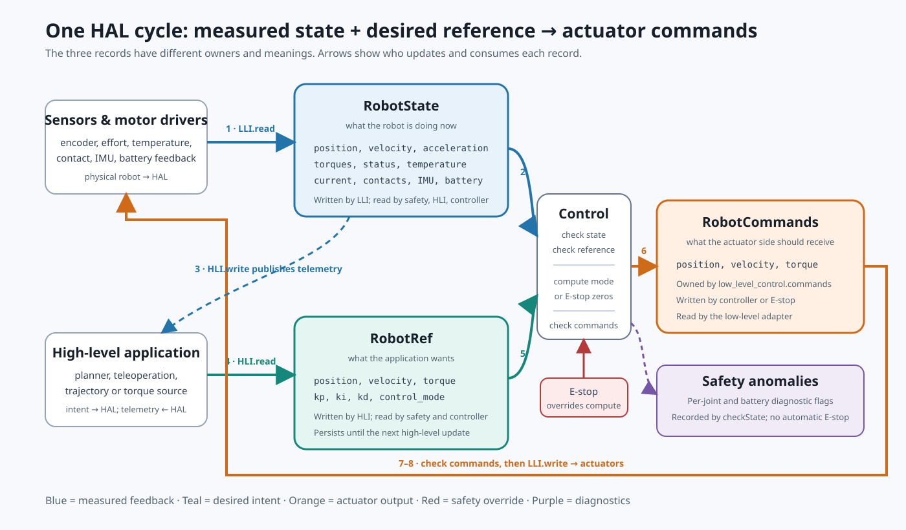
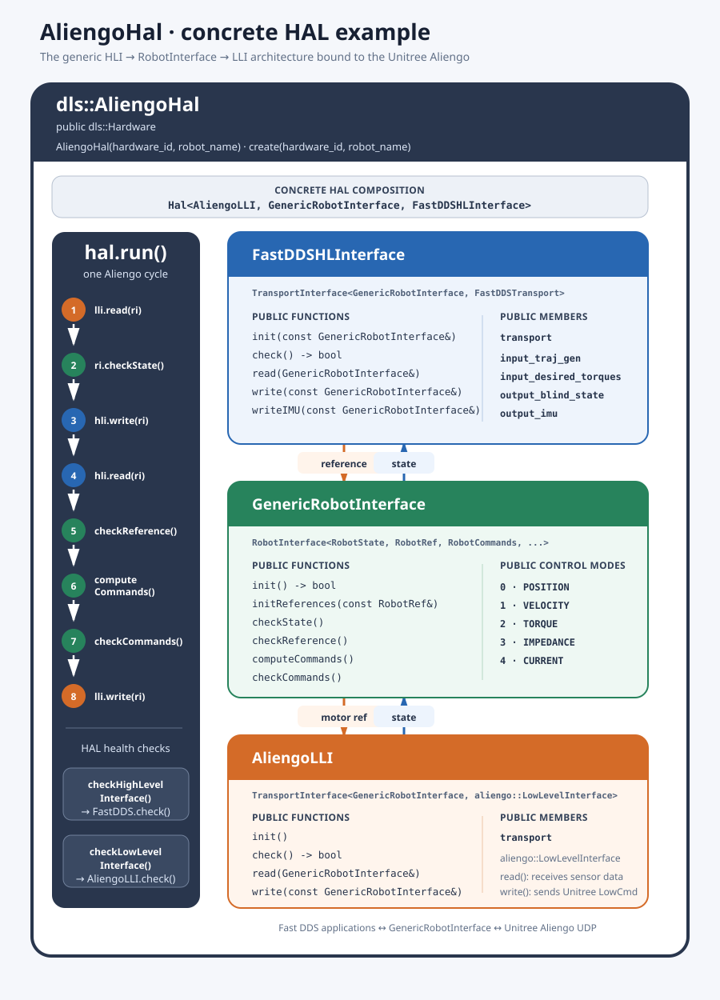

# DLS robot HAL

This repository defines a reusable C++20 hardware-abstraction-layer (HAL) structure for robots. It separates communication with high-level applications from robot-independent state, reference, safety, and control logic, and from communication with sensors and motor drivers.

The architecture is template-based: a robot integration selects a low-level interface (`LLI`), a robot interface (`RI`), and a high-level interface (`HLI`) and combines them as `Hal<LLI, RI, HLI>`. This keeps the orchestration loop independent of a particular robot and transport.


The diagram is an editable Inkscape SVG. Its layers are named **Background**, **Connections**, **HAL orchestration**, **Public interfaces**, and **Flow annotations**, so the enclosure, run cycle, API boxes, and connectors can be changed independently.

The concrete Aliengo binding is documented in the [AliengoHal example](#aliengohal-example).

## Scope

The core documentation covers the source selected by the root `CMakeLists.txt`:

- `transport_interfaces/`
- `dls_hal/`

The `aliengo_hal/` package is included only as a concrete example of binding those interfaces to a robot. This documentation excludes `aliengo_hal_old/` and every `build/` directory. The `hal/` directory is a duplicate source snapshot and is not selected by the root build, so core references below use the canonical top-level source directories.

## Architecture

### `Hal<LLI, RI, HLI>`: orchestration

`Hal` derives from the abstract `HalBase` and owns one instance of each interface. Its public surface is:

```cpp
void init(const std::string& robot_interface_config_file);
void run();
bool checkHighLevelInterface();
bool checkLowLevelInterface();
```

`run()` performs one complete exchange and control step:

1. `lli.read(ri)` updates the robot state from sensors and motor drivers.
2. `ri.checkState()` records state anomalies.
3. `hli.write(ri)` publishes robot state to high-level applications.
4. `hli.read(ri)` updates the desired reference.
5. `ri.checkReference()` validates the reference.
6. `ri.computeCommands()` produces low-level commands or applies emergency-stop commands.
7. `ri.checkCommands()` validates the generated commands.
8. `lli.write(ri)` sends the commands to the motor side.

`checkHighLevelInterface()` and `checkLowLevelInterface()` delegate to the corresponding interface's `check()` method.

### `TransportInterface<Source, Transport>`: communication contract

`TransportInterface` is the common adapter interface used to exchange a typed `Source` over a concrete transport:

```cpp
virtual void init(const Source& source);
virtual bool check();
virtual void read(Source& source);
virtual void write(const Source& source);

Transport transport;
```

The default implementations are no-ops and `check()` returns `true`. A useful transport interface should override all operations it needs. The public `transport` member holds the transport implementation used by the adapter.

The high-level interface in the core source derives from this class. `Hal` also expects the low-level side to expose the same operational contract (`init`, `check`, `read`, and `write`). The core `dls_hal/` tree leaves that adapter to robot integrations; the later Aliengo example supplies `AliengoLLI` as a concrete implementation.

### `RobotInterface`: robot-independent bridge

`RobotInterface<TState, TRef, TCommands, TLimits, TSafety, TLowLevelControl>` stores the data shared by the communication sides and coordinates safety and command computation. Its template arguments are checked at compile time against the base invariant types.

Public operations:

```cpp
bool init(const std::string& config_file);
void initReferences(const TRef& ref);
void checkState();
void checkReference();
void computeCommands();
void checkCommands();
```

Public data:

```cpp
TSafety safety;
TRef ref;
TState state;
TLowLevelControl low_level_control;
```

The communication adapters therefore receive the entire robot interface as their `Source`. A low-level adapter writes sensor feedback into `state` and reads generated values from `low_level_control.commands`; a high-level adapter writes desired values into `ref` and reads feedback from `state`.

`computeCommands()` checks `safety.anomalies.emergency_stop_triggered`. When it is set, `safety.eSTOP()` zeroes command position, velocity, and torque vectors. Otherwise, the configured low-level controller computes commands from `state` and `ref`. Commands are safety-checked after either path.

## Robot data model

The base invariant classes provide a common representation that robot-specific types can extend.

| Type | Main public information |
| --- | --- |
| `IMU` | Frame ID, quaternion and RPY orientation, angular velocity, linear acceleration, and covariance arrays |
| `RobotState` | Robot/joint names; joint position, velocity, acceleration, and torque; status, temperature, current, contacts, IMUs, and battery status |
| `RobotRef` | Control mode; desired position, velocity, torque, and PID gains |
| `RobotCommands` | Commanded position, velocity, and torque |
| `RobotLimits` | Position, velocity, torque, current, temperature, and minimum battery limits |
| `RobotSafety` | Emergency-stop state, limits, anomaly flags, and state/reference/command checks |
| `RobotLowLevelControl` | Control mode, generated commands, and control-law methods |

`GenericRobotInterface` binds the base types directly. `QuadrupedInterface` and `ArmInterface` bind lightweight derived invariant types, providing extension points for robot-family-specific data and behavior.

### State, references, and commands

These records are deliberately separate because they describe three different points in the control pipeline:



| Record | Meaning | Updated by | Read by | Lifetime |
| --- | --- | --- | --- | --- |
| `ri.state` (`TState`) | Best available measurement of the robot now | `lli.read(ri)` | State safety checks, `hli.write(ri)`, and low-level control | Initialized once, then refreshed near the start of every `run()` |
| `ri.ref` (`TRef`) | Desired motion or effort requested by the high-level application | `hli.read(ri)` or `initReferences()` | Reference safety checks and low-level control | Retained between cycles and replaced or edited when a new reference is read |
| `ri.low_level_control.commands` (`TCommands`) | Actuator-facing output selected by the current control mode | `computeCommands()` or `safety.eSTOP()` | Command safety checks and, by contract, `lli.write(ri)` | Initialized to zero; active fields are recomputed during every `run()` |

The names express direction, not freshness. A reference is not a sensor reading, and a command is not necessarily identical to its reference: impedance control, saturation, filtering, model-based control, or an emergency stop may transform the desired value before it reaches an actuator.

#### `RobotState`: measured feedback

`RobotState` is the feedback snapshot populated by a robot-specific low-level adapter. The base class contains:

| Field | Shape after `init()` | Meaning and initial value |
| --- | --- | --- |
| `robot_name` | Scalar string | Robot identifier; initially empty |
| `names` | `n_joints` strings | Joint identifiers; initially empty |
| `position`, `velocity`, `acceleration` | `n_joints` doubles each | Measured joint kinematics; initially zero |
| `torque` | `n_joints` doubles | Measured or estimated joint effort; initially zero |
| `motors_status_word` | `n_joints` unsigned integers | Driver-specific status bits; initially zero |
| `motor_temperature`, `motors_current` | `n_joints` doubles each | Motor telemetry; initially zero |
| `contacts` | `n_contacts` booleans | Contact estimates; initially `false` |
| `imu` | `n_imus` `IMU` records | Frame, quaternion, RPY, angular velocity, linear acceleration, and 3×3 covariances; numeric fields initially zero |
| `battery_status` | Scalar double | Battery feedback; initialized to `100.0` |

The base type does not encode physical units, coordinate frames, timestamps, or a validity flag. Integrations must keep those conventions consistent with their transports. It also does not make the snapshot atomic: `lli.read()` is expected to finish updating all relevant fields before the later stages of `run()` consume them.

`checkState()` compares position, velocity, torque, motor temperature, and battery values with `safety.limits` and stores per-joint anomaly flags. It also tests position, velocity, and torque for non-finite values. The check records observations; it does not stop the cycle or automatically set `anomalies.emergency_stop_triggered`.

#### Safety anomalies

`ri.safety.anomalies` is a public `RobotSafety::RobotAnomalies` record. It contains diagnostic state derived from `ri.state` and the explicit `emergency_stop_triggered` latch; it is separate from the measured state, desired reference, and generated commands.

| Anomaly field | Shape | Set when |
| --- | --- | --- |
| `joint_pos_limit_violation` | `n_joints` booleans | Position is below `position_min` or above `position_max` |
| `joint_vel_limit_violation` | `n_joints` booleans | Velocity is outside `[-velocity_max, +velocity_max]` |
| `joint_torque_limit_violation` | `n_joints` booleans | Measured torque is outside `[-torque_max, +torque_max]` |
| `nan_position_detected`, `nan_velocity_detected`, `nan_torque_detected` | `n_joints` booleans each | The corresponding value is non-finite in the current implementation |
| `inf_position_detected`, `inf_velocity_detected`, `inf_torque_detected` | `n_joints` booleans each | The corresponding value is non-finite in the current implementation |
| `motor_overheat_detected` | `n_joints` booleans | Temperature is below `motor_temperature_min` or above `motor_temperature_max` |
| `battery_charge_low` | One boolean | `battery_status` is below `percentage_battery_charge_min` |

State-limit flags are refreshed by `checkState()`. Mechanical stress is an exception: `breaking_mechanics` and the triggering torques remain latched until safety initialization clears them. All per-joint state, limit, and anomaly vectors must have the configured `n_joints` length.

`manageAnomalies()` checks state and commands, then selects recovery. Emergency stop and the fungo button take priority. Missing references and mechanical stress select damping recovery, which zeroes position and velocity commands and applies torque opposing measured joint velocity.

#### Mechanical stress: exponential exposure limit

Mechanical-stress detection runs independently for each joint in `RobotSafety::checkState()`, including when called through `GenericRobotInterface`. A joint's exposure timer runs only while both conditions hold:

- Measured position is strictly below `position_min` or above `position_max`. Position exactly at either limit is permitted.
- Absolute measured torque is strictly greater than `mechanical_stress_max_torque`. Torque at or below this threshold does not start or advance mechanical-stress timing.

The allowable continuous exposure time is:

```text
t_allowed = a * exp(-b * (abs(torque) - mechanical_stress_max_torque))
```

The detector uses the **current measured torque** at each check. Increasing torque shortens the deadline; decreasing torque above the threshold lengthens it. This is an elapsed-time comparison, not an integral of accumulated stress. Each timer uses `std::chrono::steady_clock` wall time, including in simulation.

The timer resets whenever position returns within its limits or torque returns to/below the threshold. Once elapsed time exceeds `t_allowed`, `breaking_mechanics` is latched and damping recovery is selected unless a higher-priority recovery applies. This threshold is separate from the ordinary `torque_min`/`torque_max` limits.

Add these settings under `robot_interface.safety` in `interface_config.yaml`, alongside the joint limits:

```yaml
robot_interface:
  safety:
    mechanical_stress_max_torque: 60.0 # Nm
    mechanical_stress_exp_coefficients:
      a: 2.0   # seconds; allowed time just above the torque threshold
      b: 0.02  # 1/Nm; rate at which allowed time decreases with torque
```

| Parameter | Meaning | Accepted values |
| --- | --- | --- |
| `mechanical_stress_max_torque` | Torque magnitude above which timing is eligible | Finite, non-negative; defaults to 0 Nm if omitted |
| `a` | Exponential time scale | Finite and strictly positive, in seconds |
| `b` | Exponential decay coefficient | Finite and non-negative, in 1/Nm; zero gives a constant `a`-second allowance |

Both coefficients are required when `mechanical_stress_exp_coefficients` is present. Omitting that block disables mechanical-stress detection. The old `mechanical_stress_max_time` setting is no longer used.

For the example configuration, provided position is outside its limits:

| Torque magnitude | Allowed continuous exposure |
| ---: | ---: |
| ≤ 60 Nm | Timing inactive |
| 80 Nm | 1.34 s |
| 100 Nm | 0.90 s |
| 120 Nm | 0.60 s |
| 160 Nm | 0.27 s |

`FastDDSHLInterface::write()` invokes its `FastDDSEventChecker`, which publishes one `BREAKING_MECHANICS` error containing **all joints that have triggered**, with each joint's first triggering torque in Nm. Samples are stored in `anomalies.mechanical_stress_trigger_torque`, indexed by joint. Additional joints can be recorded after recovery begins; existing samples are preserved. Names come from `state.names`, with `joint[index]` as a fallback.

Returning within limits resets the exposure timer but does **not** clear a latched fault or its recorded torque. Repeated notifications therefore describe recorded triggers, not necessarily current torque or currently out-of-limit joints. `RobotSafety::init()` clears the latch, samples, and timers. Notification throttling follows the configured `AppLogger` behavior.

##### Plotting the curve in Python

Install `numpy` and `matplotlib`, then run the following function with the same coefficients and torque threshold as the YAML configuration. The shaded region means timing is inactive, not that the allowed time is zero.

```python
import numpy as np
import matplotlib.pyplot as plt


def plot_mechanical_stress_curve(a=2.0, b=0.02, threshold=60.0,
                                max_torque=200.0):
    """Plot allowed exposure time while outside joint position limits."""
    if (not np.isfinite([a, b, threshold, max_torque]).all()
            or a <= 0 or b < 0 or threshold < 0 or max_torque <= threshold):
        raise ValueError("Require finite a > 0, b >= 0, and max_torque > threshold >= 0.")

    torque = np.linspace(threshold, max_torque, 501)[1:]
    allowed_time = a * np.exp(-b * (torque - threshold))

    fig, ax = plt.subplots(figsize=(8, 4.5))
    ax.axvspan(0, threshold, color="green", alpha=0.12,
               label="No mechanical-stress timing")
    ax.axvline(threshold, color="gray", linestyle="--")
    ax.plot(torque, allowed_time, label="Exponential exposure limit")
    ax.set(
        xlabel="Torque magnitude [Nm]",
        ylabel="Allowed continuous exposure [s]",
        title="Mechanical stress — position outside limits",
        xlim=(0, max_torque),
        ylim=(0, a * 1.1),
    )
    ax.grid(alpha=0.3)
    ax.legend()
    fig.tight_layout()
    plt.show()
    return ax


plot_mechanical_stress_curve()
```

#### `RobotRef`: desired behavior

`RobotRef` is the high-level request. All vector fields are sized to `n_joints` and initialized to zero:

| Field | Meaning | Used by current controller |
| --- | --- | --- |
| `position` | Desired joint position | Position and impedance modes |
| `velocity` | Desired joint velocity | Velocity and impedance modes |
| `torque` | Desired feed-forward joint torque | Torque and impedance modes |
| `kp`, `kd` | Proportional and derivative gains per joint | Impedance mode |
| `ki` | Integral gain per joint | Not currently used |
| `control_mode` | Requested/configured numeric mode | Initialized from YAML, but not currently consulted during command computation |

The controller actually selects its branch from `ri.low_level_control.control_mode`, which is initialized from the same `low_level_control.mode` YAML key. Changing only `ri.ref.control_mode` at runtime therefore does not change modes in the present implementation.

`checkReference()` visits desired position, velocity, and torque values. The current code calls `std::clamp` but does not assign the returned value and accepts the reference as `const`; consequently, it does **not** modify an out-of-range reference. Its boolean return is also not propagated by `RobotInterface::checkReference()`. Treat it as a validation hook that still needs enforcement logic before relying on it as a safety boundary.

#### `RobotCommands`: actuator-facing output

`RobotCommands` contains `position`, `velocity`, and `torque`, each sized to `n_joints` and initialized to zero. It lives inside `ri.low_level_control`, rather than directly in `RobotInterface`, because it is the output of the selected low-level control law:

```text
ri.state + ri.ref
        │
        ▼
ri.low_level_control.computeCommands(...)
        │
        ▼
ri.low_level_control.commands
```

Position, velocity, and torque modes copy only their corresponding reference vector. Impedance mode computes the torque vector from measured and desired position/velocity plus feed-forward torque. Fields not written by the active mode keep their previous values, so a low-level adapter should interpret commands according to `low_level_control.control_mode`, not assume every vector was refreshed.

If `safety.anomalies.emergency_stop_triggered` is true, computation is bypassed and all three command vectors are filled with zero. `computeCommands()` then calls `checkCommands()`, and the outer `Hal::run()` calls it once more. As with reference checking, the current command check calls `std::clamp` without storing its result, so it does not presently saturate commands.

The generic adapter contract is that `lli.write(ri)` consumes `ri.low_level_control.commands`. The current `AliengoLLI::write()` instead maps `ri.ref.position`, `velocity`, `kp`, `kd`, and `torque` directly into Unitree `LowCmd`. That bypasses computed commands and the E-stop command vectors; it is an implementation exception to fix before treating the generic command path as enforced on Aliengo.

### Per-cycle data timeline

One call to `Hal::run()` creates this ordering guarantee:

1. Complete the state snapshot and inspect its anomalies.
2. Publish that state before receiving the next reference.
3. Read and inspect the reference.
4. Compute commands from the state and reference from this same cycle, unless E-stop supplies zero commands.
5. Inspect and send the resulting actuator output.

No synchronization, deadline, sequence number, or stale-data policy is implemented by the three records themselves. Those concerns belong in the transport adapters or in robot-specific derived types.

### Control modes

`RobotLowLevelControl::CONTROL_MODE` defines:

| Value | Mode | Current behavior |
| ---: | --- | --- |
| 0 | `POSITION_CONTROL` | Copies reference position to command position |
| 1 | `VELOCITY_CONTROL` | Copies reference velocity to command velocity |
| 2 | `TORQUE_CONTROL` | Copies reference torque to command torque |
| 3 | `IMPEDANCE_CONTROL` | Computes `torque + kp * position_error + kd * velocity_error` per joint |
| 4 | `CURRENT_CONTROL` | Placeholder; reports that the mode is not implemented |

## High-level Fast DDS adapter

`FastDDSHLInterface` derives from `TransportInterface<GenericRobotInterface, FastDDSTransport>`. `FastDDSTransport` is a DLS plugin configured for the signals domain.

Its public interface overrides `init(const GenericRobotInterface&)`, `check()`, `read()`, and `write()` and adds `writeIMU()`.

Data entering the HAL:

| Input | Robot interface destination |
| --- | --- |
| Trajectory-generator joint position | `ref.position` |
| Trajectory-generator joint velocity | `ref.velocity` |
| Desired torques | `ref.torque` |
| Trajectory-generator gains | `ref.kp`, `ref.kd` |

Data leaving the HAL:

| Robot interface source | Output |
| --- | --- |
| Joint position, velocity, acceleration, effort, and temperature | Blind-state message |
| Foot contacts | Blind-state message |
| IMU frame, pose, velocities, accelerations, and covariances | IMU message |

`check()` succeeds only when transport inputs are receiving data and outputs are unique.

## AliengoHal example

`dls::AliengoHal` demonstrates a concrete selection of the generic HAL interfaces:

```cpp
Hal<AliengoLLI, GenericRobotInterface, FastDDSHLInterface>
```



The Aliengo diagram is an editable Inkscape SVG. It preserves the vertical structure of the generic diagram while replacing each template parameter with its concrete type and exposing its public functions and members.

### `dls::AliengoHal`

`AliengoHal` derives from the DLS `Hardware` class. Its constructor accepts a hardware ID and robot name, constructs the concrete HAL specialization, and initializes it. The class also exposes a factory method:

```cpp
Hardware* create(const std::string& hardware_id,
                 const std::string& robot_name);
```

| HAL role | Concrete type | Responsibility |
| --- | --- | --- |
| High-level interface | `FastDDSHLInterface` | Receives trajectory and torque references and publishes robot state and IMU data over Fast DDS |
| Robot interface | `GenericRobotInterface` | Holds the generic robot model and performs safety checks and command computation |
| Low-level interface | `AliengoLLI` | Converts Unitree observations into robot state and sends Unitree low-level motor commands |

The inherited HAL control cycle remains unchanged: it reads Aliengo feedback, checks and publishes the state, receives high-level references, computes and checks commands, and writes to the Aliengo low-level interface. The HAL health methods delegate to `FastDDSHLInterface::check()` and `AliengoLLI::check()`.

### `AliengoLLI`

`AliengoLLI` binds the generic robot source to the Unitree transport:

```cpp
TransportInterface<GenericRobotInterface, aliengo::LowLevelInterface>
```

Its public functions are `init()`, `check()`, `read()`, and `write()`. The inherited public `transport` member is an `aliengo::LowLevelInterface`, which wraps the Unitree low-level UDP and safety objects.

`read(GenericRobotInterface&)` receives a Unitree `LowState` and updates:

- Joint position, velocity, acceleration, estimated torque, and motor temperature.
- Four foot-contact flags using configurable force thresholds.
- IMU quaternion, RPY orientation, angular velocity, and linear acceleration.

`write(const GenericRobotInterface&)` maps position, velocity, proportional gain, derivative gain, and torque references to Unitree `LowCmd::motorCmd`, then sends the result through `SendLowCmd()`.

The adapter loads its foot-contact thresholds from `aliengo.yaml`. Its default configuration location is set when the package is configured; `DLS_ALIENGO_HAL_CONFIG` can override it with a complete YAML file path.

## Configuration

`RobotInterface::init(config_file)` loads a YAML configuration from the configured default directory, currently `/usr/share/config/dls_hal`, or from the directory stored in `DLS_ROBOT_INTERFACE_PATH`. The argument is a configuration basename: the implementation appends `.yaml`.

Required configuration keys are:

```yaml
general:
  n_joints: 12
  n_contacts: 4
  n_imus: 1

safety:
  e_stop: 0

low_level_control:
  mode: 2
```

The supplied `quadruped_interface_config.yaml` uses these values. Initialization sizes all joint, contact, IMU, limit, reference, and command containers. Limits default to the widest representable values, while minimum battery charge defaults to zero.

## Extending the HAL

To add a robot:

1. Derive robot-specific state, reference, command, and limit types from `RobotState`, `RobotRef`, `RobotCommands`, and `RobotLimits`.
2. Derive safety and low-level-control types from the matching `RobotSafety<...>` and `RobotLowLevelControl<...>` specializations.
3. Define a concrete alias or empty derived class from `RobotInterface<...>` using those six types.
4. Implement an LLI adapter that maps hardware feedback to `ri.state` and maps `ri.low_level_control.commands` to motor-driver commands.
5. Select or implement an HLI adapter that maps application messages to `ri.ref` and publishes `ri.state`.
6. Instantiate `Hal<YourLLI, YourRobotInterface, YourHLI>` and call `init()` once, followed by `run()` at the desired control rate.

An adapter based directly on the transport contract typically has this shape:

```cpp
class MyLowLevelInterface
    : public TransportInterface<MyRobotInterface, MyTransport> {
public:
    void init(const MyRobotInterface& robot) override;
    bool check() override;
    void read(MyRobotInterface& robot) override;        // fill robot.state
    void write(const MyRobotInterface& robot) override; // send robot.low_level_control.commands
};
```

## Building and testing

The project requires CMake 3.16.2 or newer, a C++20 compiler, `yaml-cpp`, and the DLS2 plugin/domain/topic/signal packages used by the Fast DDS targets.

```sh
cmake -S . -B build
cmake --build build
ctest --test-dir build --output-on-failure
```

### Python bindings

The optional nanobind module exposes the generic robot data model and a
Python-facing `Hal`. Its low- and high-level interfaces are regular Python
objects; any missing `init`, `read`, or `write` method is treated as a no-op,
and a missing `check` method returns `True`.

Install nanobind and enable the module when configuring:

```sh
python3 -m pip install nanobind
cmake -S . -B build \
  -DDLS_HAL_BUILD_PYTHON_BINDINGS=ON \
  -Dnanobind_DIR="$(python3 -m nanobind --cmake_dir)"
cmake --build build --target dls_hal_python
```

Add the directory containing the built module to `PYTHONPATH`, then use it as
shown below. A runnable version is available in `python/example.py`.

```python
import dls_hal

class LowLevelInterface:
    def read(self, robot):
        robot.state.position = [0.0] * len(robot.state.position)

    def write(self, robot):
        print(robot.low_level_control.commands.torque)

class HighLevelInterface:
    def read(self, robot):
        robot.ref.torque = [1.0] * len(robot.ref.torque)

def main():
    hal = dls_hal.Hal(LowLevelInterface(), HighLevelInterface())
    hal.init("quadruped_interface_config")
    hal.run()
    print(hal.robot_interface.state.position)

if __name__ == "__main__":
    main()
```

The robot-interface test constructs a `QuadrupedInterface`, loads the example configuration, verifies vector sizes and basic access, and calls `computeCommands()`.

add info specifically for generic robot interface and fastdddshlinterface