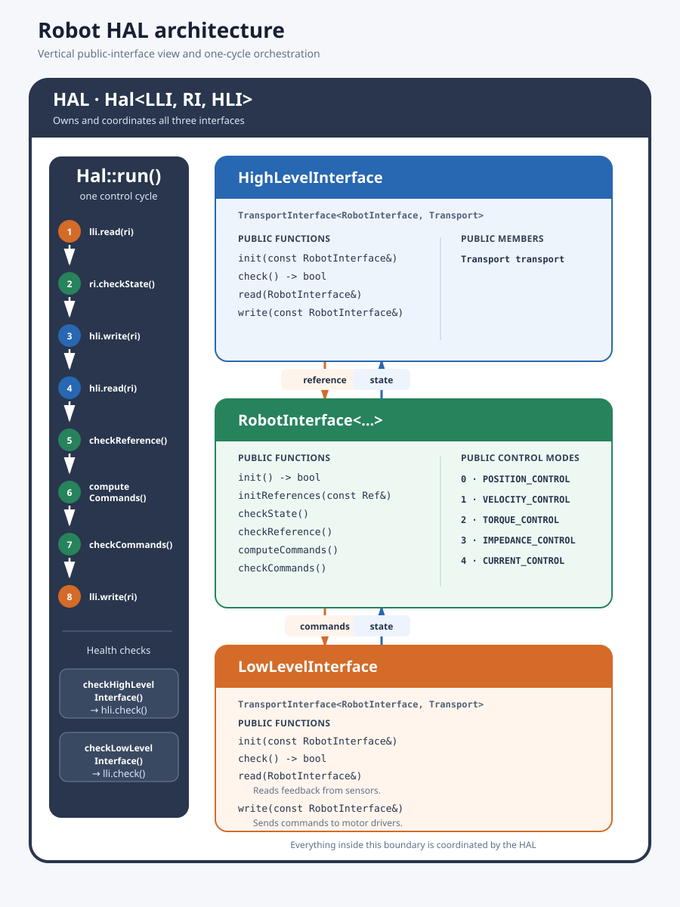

# DLS robot HAL

This repository defines a reusable C++20 hardware-abstraction-layer (HAL) structure for robots. It separates communication with high-level applications from robot-independent state, reference, safety, and control logic, and from communication with sensors and motor drivers.

The architecture is template-based: a robot integration selects a low-level interface (`LLI`), a robot interface (`RI`), and a high-level interface (`HLI`) and combines them as `Hal<LLI, RI, HLI>`. This keeps the orchestration loop independent of a particular robot and transport.



The diagram is an editable Inkscape SVG. Its layers are named **Background**, **Connections**, **HAL orchestration**, **Public interfaces**, and **Flow annotations**, so the enclosure, run cycle, API boxes, and connectors can be changed independently.

The concrete Aliengo binding is documented in the [AliengoHal example](#aliengohal-example).

## Scope

The core documentation covers the source selected by the root `CMakeLists.txt`:

- `transport_interfaces/`
- `dls_hal/`

The `aliengo_hal/` package is included only as a concrete example of binding those interfaces to a robot. This documentation excludes `aliengo_hal_old/` and every `build/` directory. The `hal/` directory is a duplicate source snapshot and is not selected by the root build, so core references below use the canonical top-level source directories.

## Architecture

### `Hal<LLI, RI, HLI>`: orchestration

`Hal` derives from the abstract `HalBase` and owns one instance of each interface. Its public surface is:

```cpp
void init();
void run();
bool checkHighLevelInterface();
bool checkLowLevelInterface();
```

`run()` performs one complete exchange and control step:

1. `lli.read(ri)` updates the robot state from sensors and motor drivers.
2. `ri.checkState()` records state anomalies.
3. `hli.write(ri)` publishes robot state to high-level applications.
4. `hli.read(ri)` updates the desired reference.
5. `ri.checkReference()` validates the reference.
6. `ri.computeCommands()` produces low-level commands or applies emergency-stop commands.
7. `ri.checkCommands()` validates the generated commands.
8. `lli.write(ri)` sends the commands to the motor side.

`checkHighLevelInterface()` and `checkLowLevelInterface()` delegate to the corresponding interface's `check()` method.

### `TransportInterface<Source, Transport>`: communication contract

`TransportInterface` is the common adapter interface used to exchange a typed `Source` over a concrete transport:

```cpp
virtual void init(const Source& source);
virtual bool check();
virtual void read(Source& source);
virtual void write(const Source& source);

Transport transport;
```

The default implementations are no-ops and `check()` returns `true`. A useful transport interface should override all operations it needs. The public `transport` member holds the transport implementation used by the adapter.

The high-level interface in the core source derives from this class. `Hal` also expects the low-level side to expose the same operational contract (`init`, `check`, `read`, and `write`). The core `dls_hal/` tree leaves that adapter to robot integrations; the later Aliengo example supplies `AliengoLLI` as a concrete implementation.

### `RobotInterface`: robot-independent bridge

`RobotInterface<TState, TRef, TCommands, TLimits, TSafety, TLowLevelControl>` stores the data shared by the communication sides and coordinates safety and command computation. Its template arguments are checked at compile time against the base invariant types.

Public operations:

```cpp
bool init();
void initReferences(const TRef& ref);
void checkState();
void checkReference();
void computeCommands();
void checkCommands();
```

Public data:

```cpp
TSafety safety;
TRef ref;
TState state;
TLowLevelControl low_level_control;
```

The communication adapters therefore receive the entire robot interface as their `Source`. A low-level adapter writes sensor feedback into `state` and reads generated values from `low_level_control.commands`; a high-level adapter writes desired values into `ref` and reads feedback from `state`.

`computeCommands()` checks `safety.e_stop_triggered`. When it is set, `safety.eSTOP()` zeroes command position, velocity, and torque vectors. Otherwise, the configured low-level controller computes commands from `state` and `ref`. Commands are safety-checked after either path.

## Robot data model

The base invariant classes provide a common representation that robot-specific types can extend.

| Type | Main public information |
| --- | --- |
| `IMU` | Frame ID, quaternion and RPY orientation, angular velocity, linear acceleration, and covariance arrays |
| `RobotState` | Robot/joint names; joint position, velocity, acceleration, and torque; status, temperature, current, contacts, IMUs, and battery status |
| `RobotRef` | Control mode; desired position, velocity, torque, and PID gains |
| `RobotCommands` | Commanded position, velocity, and torque |
| `RobotLimits` | Position, velocity, torque, current, temperature, and minimum battery limits |
| `RobotSafety` | Emergency-stop state, limits, anomaly flags, and state/reference/command checks |
| `RobotLowLevelControl` | Control mode, generated commands, and control-law methods |

`GenericRobotInterface` binds the base types directly. `QuadrupedInterface` and `ArmInterface` bind lightweight derived invariant types, providing extension points for robot-family-specific data and behavior.

### Control modes

`RobotLowLevelControl::CONTROL_MODE` defines:

| Value | Mode | Current behavior |
| ---: | --- | --- |
| 0 | `POSITION_CONTROL` | Copies reference position to command position |
| 1 | `VELOCITY_CONTROL` | Copies reference velocity to command velocity |
| 2 | `TORQUE_CONTROL` | Copies reference torque to command torque |
| 3 | `IMPEDANCE_CONTROL` | Computes `torque + kp * position_error + kd * velocity_error` per joint |
| 4 | `CURRENT_CONTROL` | Placeholder; reports that the mode is not implemented |

## High-level Fast DDS adapter

`FastDDSHLInterface` derives from `TransportInterface<GenericRobotInterface, FastDDSTransport>`. `FastDDSTransport` is a DLS plugin configured for the signals domain.

Its public interface overrides `init(const GenericRobotInterface&)`, `check()`, `read()`, and `write()` and adds `writeIMU()`.

Data entering the HAL:

| Input | Robot interface destination |
| --- | --- |
| Trajectory-generator joint position | `ref.position` |
| Trajectory-generator joint velocity | `ref.velocity` |
| Desired torques | `ref.torque` |
| Trajectory-generator gains | `ref.kp`, `ref.kd` |

Data leaving the HAL:

| Robot interface source | Output |
| --- | --- |
| Joint position, velocity, acceleration, effort, and temperature | Blind-state message |
| Foot contacts | Blind-state message |
| IMU frame, pose, velocities, accelerations, and covariances | IMU message |

`check()` succeeds only when transport inputs are receiving data and outputs are unique.

## AliengoHal example

`dls::AliengoHal` demonstrates a concrete selection of the generic HAL interfaces:

```cpp
Hal<AliengoLLI, GenericRobotInterface, FastDDSHLInterface>
```


The Aliengo diagram is an editable Inkscape SVG. It preserves the vertical structure of the generic diagram while replacing each template parameter with its concrete type and exposing its public functions and members.

### `dls::AliengoHal`

`AliengoHal` derives from the DLS `Hardware` class. Its constructor accepts a hardware ID and robot name, constructs the concrete HAL specialization, and initializes it. The class also exposes a factory method:

```cpp
Hardware* create(const std::string& hardware_id,
                 const std::string& robot_name);
```

| HAL role | Concrete type | Responsibility |
| --- | --- | --- |
| High-level interface | `FastDDSHLInterface` | Receives trajectory and torque references and publishes robot state and IMU data over Fast DDS |
| Robot interface | `GenericRobotInterface` | Holds the generic robot model and performs safety checks and command computation |
| Low-level interface | `AliengoLLI` | Converts Unitree observations into robot state and sends Unitree low-level motor commands |

The inherited HAL control cycle remains unchanged: it reads Aliengo feedback, checks and publishes the state, receives high-level references, computes and checks commands, and writes to the Aliengo low-level interface. The HAL health methods delegate to `FastDDSHLInterface::check()` and `AliengoLLI::check()`.

### `AliengoLLI`

`AliengoLLI` binds the generic robot source to the Unitree transport:

```cpp
TransportInterface<GenericRobotInterface, aliengo::LowLevelInterface>
```

Its public functions are `init()`, `check()`, `read()`, and `write()`. The inherited public `transport` member is an `aliengo::LowLevelInterface`, which wraps the Unitree low-level UDP and safety objects.

`read(GenericRobotInterface&)` receives a Unitree `LowState` and updates:

- Joint position, velocity, acceleration, estimated torque, and motor temperature.
- Four foot-contact flags using configurable force thresholds.
- IMU quaternion, RPY orientation, angular velocity, and linear acceleration.

`write(const GenericRobotInterface&)` maps position, velocity, proportional gain, derivative gain, and torque references to Unitree `LowCmd::motorCmd`, then sends the result through `SendLowCmd()`.

The adapter loads its foot-contact thresholds from `aliengo.yaml`. Its default configuration location is set when the package is configured; `DLS_ALIENGO_HAL_CONFIG` can override it with a complete YAML file path.

## Configuration

`RobotInterface::init()` is intended to load a YAML configuration from the configured default directory, currently `/usr/share/config/dls_hal`, or from the complete file path stored in `DLS_ROBOT_INTERFACE_PATH`. The current implementation still constructs the default path from an undeclared `config_file` variable, so initialization does not compile until a configuration name is restored as a parameter/member or the default filename is defined.

Required configuration keys are:

```yaml
general:
  n_joints: 12
  n_contacts: 4
  n_imus: 1

safety:
  e_stop: 0

low_level_control:
  mode: 2
```

The supplied `quadruped_interface_config.yaml` uses these values. Initialization sizes all joint, contact, IMU, limit, reference, and command containers. Limits default to the widest representable values, while minimum battery charge defaults to zero.

## Extending the HAL

To add a robot:

1. Derive robot-specific state, reference, command, and limit types from `RobotState`, `RobotRef`, `RobotCommands`, and `RobotLimits`.
2. Derive safety and low-level-control types from the matching `RobotSafety<...>` and `RobotLowLevelControl<...>` specializations.
3. Define a concrete alias or empty derived class from `RobotInterface<...>` using those six types.
4. Implement an LLI adapter that maps hardware feedback to `ri.state` and maps `ri.low_level_control.commands` to motor-driver commands.
5. Select or implement an HLI adapter that maps application messages to `ri.ref` and publishes `ri.state`.
6. Instantiate `Hal<YourLLI, YourRobotInterface, YourHLI>` and call `init()` once, followed by `run()` at the desired control rate.

An adapter based directly on the transport contract typically has this shape:

```cpp
class MyLowLevelInterface
    : public TransportInterface<MyRobotInterface, MyTransport> {
public:
    void init(const MyRobotInterface& robot) override;
    bool check() override;
    void read(MyRobotInterface& robot) override;        // fill robot.state
    void write(const MyRobotInterface& robot) override; // send robot.low_level_control.commands
};
```

## Building and testing

The project requires CMake 3.16.2 or newer, a C++20 compiler, `yaml-cpp`, and the DLS2 plugin/domain/topic/signal packages used by the Fast DDS targets.

```sh
cmake -S . -B build
cmake --build build
ctest --test-dir build --output-on-failure
```

The robot-interface test is intended to construct a `QuadrupedInterface`, load the example configuration, verify vector sizes and basic access, and call `computeCommands()`. It currently calls `init("quadruped_interface_config")`, which no longer matches the declared no-argument `RobotInterface::init()`.
