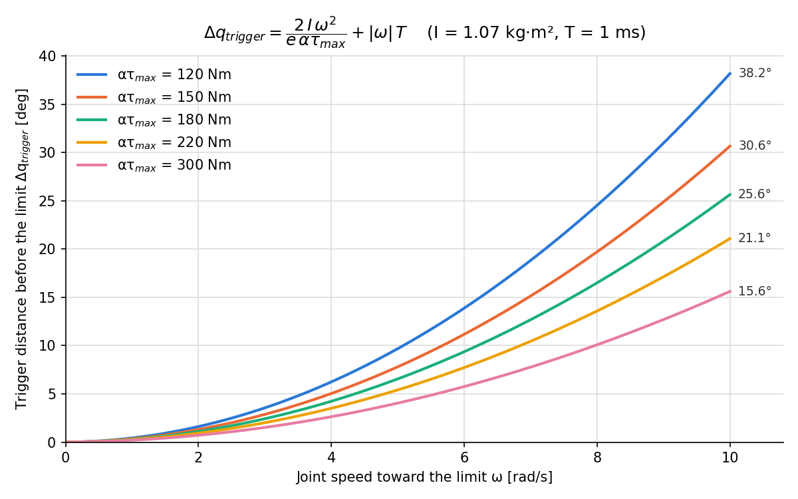

# Dynamic Joint Limit Protection: Spring-Damper Gain and Trigger Derivation

## 1. Objective

The goal is to implement a joint-limit protection mechanism for a
rotational joint using a virtual spring-damper:

$$
\tau_{protect} = -k x - d \dot{x}
$$

where:

-   $x$ is the penetration inside the protection region:

$$
x = q-q_{trigger}
$$

-   $k$ is the virtual spring stiffness \[Nm/rad\]
-   $d$ is the virtual damping coefficient \[Nms/rad\]

The protection is a last-resort safety mechanism that is triggered only when the remaining distance to the hard limit has shrunk to the stopping distance of the virtual brake when the brake is allowed its torque budget $\alpha\tau_{max}$, with $\alpha \in (0, 1]$ (by default $\alpha = 1$: the full torque limit). At activation the brake demands $\alpha\tau_{max}$; the demand then decays along the transient. If the protection fired later, the brake would need more than its budget and, past $\tau_{max}$, it would saturate and the joint would overshoot. Firing earlier would intervene when it is not needed (see Section 6).

------------------------------------------------------------------------

# 2. Second-order system formulation

After activation, assuming the protection torque overrides the nominal
controller:

$$
I\ddot{x}+d\dot{x}+kx=0
$$

where $I$ is the equivalent inertia seen at the joint.

Dividing by $I$:

$$
\ddot{x}+\frac{d}{I}\dot{x}+\frac{k}{I}x=0
$$

The standard second-order form is:

$$
\ddot{x}+2\zeta\omega_n\dot{x}+\omega_n^2x=0
$$

with:

$$
\omega_n=\sqrt{\frac{k}{I}}
$$

and:

$$
d=2\zeta\sqrt{kI}
$$

For critical damping:

$$
\boxed{\zeta=1}
$$

therefore:

$$
d=2\sqrt{kI}
$$

Critical damping provides the fastest response without oscillations.

------------------------------------------------------------------------

# 3. Critical damping response

At the instant of activation:

$$
x(0)=0
$$

$$
\dot{x}(0)=\omega
$$

where $\omega$ is the current joint velocity towards the limit.

For critical damping:

$$
x(t)=(C_1+C_2t)e^{-\omega_nt}
$$

Using the initial conditions:

$$
C_1=0
$$

and:

$$
C_2=\omega
$$

therefore:

$$
x(t)=\omega t e^{-\omega_nt}
$$

------------------------------------------------------------------------

# 4. Maximum penetration

The maximum penetration is found from:

$$
\dot{x}=0
$$

Derivative:

$$
\dot{x}=\omega e^{-\omega_nt}(1-\omega_nt)
$$

Therefore:

$$
t_{max}=\frac{1}{\omega_n}
$$

Substituting:

$$
x_{max} = \omega\frac{1}{\omega_n}e^{-1}
$$

hence:

$$
x_{max} = \frac{\omega}{e}\sqrt{\frac{I}{k}}
$$

The factor $e$ comes from the exponential decay term evaluated at the
maximum penetration.

------------------------------------------------------------------------

# 5. Gain computation

The objective is to stop exactly within the available distance:

$$
x_{max}=\Delta q
$$

where $\Delta q$ is the distance between the anchor and the hard limit.
The anchor $q_{trigger}$ is the joint position at the cycle in which the
activation is detected, clamped within the position limits. If the joint
is already past the limit, the anchor is the limit itself and there is no
distance left to size $k$ on: the gain is then set by the actuator torque
instead (see "Gain cap" below).

Using the previous equation:

$$
\Delta q = \frac{\omega}{e}\sqrt{\frac{I}{k}}
$$

Solving for $k$:

$$
k = \frac{I\omega^2}{e^2\Delta q^2}
$$

The damping coefficient is then:

$$
d=2\sqrt{kI}
$$

This pair of gains is consistent with the actual spring-damper
transient.

## Gain cap

The formula above has no upper bound: as $\Delta q \to 0$ (joint at or
past the limit, or activated just before it), $k \to \infty$. The actuator
cannot follow: the command is clamped to the torque limit, the linear
solution no longer holds, and a huge $d$ turns $-d\dot{x}$ into bang-bang
chatter around $\dot{x} = 0$ (in discrete time, explicit damping is
unstable for $dT/I > 2$). A stiffer $k$ does not brake harder than the
torque limit allows; it only saturates.

The gain is therefore bounded by $k_{max}$, the stiffest gain whose torque
the actuator can deliver. When the anchor is clamped to the limit, the
joint can start with a penetration

$$
p_0 = x(0) = q - q_{trigger} \ge 0
$$

and the critically damped torque magnitude is still largest at
activation, where it is

$$
|\tau_{peak}| = kp_0 + d\omega = kp_0 + 2\sqrt{I}\,\omega\sqrt{k}
$$

$k_{max}$ makes this peak equal the torque available in the braking
direction, $\tau_{avail}$ (`torque_min` magnitude for the upper limit,
`torque_max` for the lower one):

$$
p_0k_{max} + 2\sqrt{I}\,\omega\sqrt{k_{max}} = \tau_{avail}
$$

a quadratic in $\sqrt{k_{max}}$, whose positive root is

$$
\boxed{\sqrt{k_{max}} = \frac{-\sqrt{I}\,\omega + \sqrt{I\omega^2 + p_0\tau_{avail}}}{p_0}}
\qquad (p_0 > 0)
$$

and, without initial penetration (only damping at activation),

$$
\sqrt{k_{max}} = \frac{\tau_{avail}}{2\sqrt{I}\,\omega}
\quad\Rightarrow\quad
k_{max} = \frac{\tau_{avail}^2}{4I\omega^2}
\qquad (p_0 = 0)
$$

The last expression is the gain of Section 5 evaluated at the trigger
distance with $\alpha = 1$ (Section 7): $k_{max}$ is exactly the gain the
brake would get if it fired at the last moment it can work without
saturating.

The gain is then chosen as:

-   **outside the limit** ($q \ge q_{max}$, or $q \le q_{min}$): $k = k_{max}$.
    There is no room left; the joint is braked as hard as possible
    without saturating. It still overshoots, but no gain could stop it
    sooner than the torque limit allows.
-   **inside the limit**: $k = \min(k_{distance}, k_{max})$, with
    $k_{distance}$ the gain of Section 5. With real room before the limit
    the cap is inactive; it only kicks in when $\Delta q$ is tiny.

$\Delta q$ keeps a small floor ($10^{-6}$ rad) only to avoid a division by
zero. $\tau_{avail}$ is the full torque limit, not $\alpha\tau_{max}$.

A joint that is past the limit but already moving back inside
($\omega \le 0$, no push) is not activated: there is nothing to absorb, and
activating would latch zero gains that override the controller with zero
torque.

------------------------------------------------------------------------

# 6. Dynamic trigger condition

The trigger distance must match the stopping distance of the braking law
that will actually be applied.

The gains (Section 5) and the trigger answer two different questions
about the same critically damped transient:

-   **Gains**: given $\Delta q$, which $k$ and $d$ stop the joint exactly
    at the limit? For any $\Delta q$, however small, Section 5 returns
    such gains, but nothing guarantees that the actuator can deliver the
    torque they require.
-   **Trigger**: what is the smallest $\Delta q$ for which the gains of
    Section 5 stay within the torque budget $\alpha\tau_{max}$ for the
    whole transient?

## Torque along the whole transient

From $x(t)=\omega t e^{-\omega_nt}$, the protection torque
$\tau_{protect}=I\ddot{x}$ along the whole braking is:

$$
\tau_{protect}(t) = -I\omega\omega_n e^{-\omega_nt}(2-\omega_nt)
$$

Its magnitude is largest at activation ($t=0$), where it equals
$2I\omega\omega_n$. It then decreases, crosses zero at
$t=\frac{2}{\omega_n}$, and the small lobe that follows (pulling the joint
back towards the anchor) never exceeds about $2.5\%$ of the peak.
Therefore, keeping the torque within a bound over the whole transient is
exactly the same condition as keeping it within that bound at
activation.

If the protection is activated later than the trigger (smaller
$\Delta q$), the gains still aim at stopping at the limit, but they require
more than the budget at the start. As long as the demand stays below
$\tau_{max}$ the linear solution still holds and the joint still stops at
the limit. Beyond $\tau_{max}$ the recovery command is clamped to the
torque limit, the linear solution no longer holds and the joint
overshoots. If it is activated earlier, the joint is braked more gently
and still stops at the limit.

## Peak torque at activation

At $t=0$:

$$
x=0
$$

therefore the spring contribution is zero:

$$
\tau_s=-kx=0
$$

Only the damping term contributes:

$$
|\tau_{peak}|=d|\omega|
$$

Using:

$$
d=\frac{2I\omega}{e\Delta q}
$$

we obtain:

$$
|\tau_{peak}|= \frac{2I\omega^2}{e\Delta q}
$$

The trigger is selected so that the peak torque equals the torque budget:

$$
|\tau_{peak}|=\alpha\tau_{max}
$$

therefore:

$$
\Delta q_{trigger} = \frac{2I\omega^2}{e\alpha\tau_{max}}
$$

A delay margin is added for delay compensation:

$$
\Delta q_{trigger} = \frac{2I\omega^2}{e\alpha\tau_{max}} + |\omega|T
$$

where $T$ is the control period.

## Torque budget scaling

$\tau_{max}$ is the joint torque limit (`torque_max` / `torque_min`, the
same values the commands are clamped to), and $\alpha$ is
`virtual_joint_limit_torque_scale`, in $(0, 1]$, default $1$.

With $\alpha = 1$ the trigger fires at the last moment the brake can
work without saturating: the peak torque equals the torque limit, and any
model error (inertia underestimated, velocity prediction error, external
torque pushing towards the limit, detection later than one control
period) makes it saturate and overshoot.

With $\alpha < 1$ the trigger distance grows by a factor $1/\alpha$, the
protection fires earlier and, since the gains use the actual $\Delta q$,
the peak torque at activation is only $\alpha\tau_{max}$. The remaining
$(1-\alpha)\tau_{max}$ is headroom: model errors are absorbed without
reaching the clamp, so the transient stays linear and the joint still
stops at the limit. The cost is a more frequent intervention during
aggressive motions; e.g. $\alpha = 0.9$ gives about $11\%$ longer trigger
distance and $10\%$ torque headroom.

A multiplicative factor is used instead of a fixed offset
$\tau_{max}-\varepsilon$ so that the relative margin is the same on joints
with different torque limits. Since the trigger depends on $I/\tau$,
scaling the torque by $\alpha$ is almost equivalent to scaling the inertia
by $1/\alpha$; the torque factor is kept separate so that the inertia
remains a physical estimate and $\alpha$ directly states the headroom.

## Evaluation at every control cycle

The trigger is not computed once: at every control cycle the threshold

$$
q_{limit} - \Delta q_{trigger}(\omega)
$$

is recomputed from the current velocity, and the protection is activated
when the joint position crosses it.

## Delay compensation with the current torque

The crossing happens between two samples and is only detected at the
next one. During that period the torque currently applied to the joint
(measured, $\tau_{meas}$) still accelerates it. The trigger therefore uses
the velocity predicted one control period ahead:

$$
\omega_{next} = \omega + \frac{\tau_{meas}}{I}T
$$

$$
\Delta q_{trigger} = \frac{2I\omega_{next}^2}{e\alpha\tau_{max}} + |\omega_{next}|T
$$

## Distance used in the gains

The gains of Section 5 use the actual distance $\Delta q$ from the anchor
to the limit, not $\Delta q_{trigger}$. Since the activation is detected up
to one control period after the crossing, $\Delta q$ can be up to
$|\omega|T$ smaller than $\Delta q_{trigger}$. The delay margin keeps

$$
\Delta q \geq \frac{2I\omega^2}{e\alpha\tau_{max}}
$$

so the peak torque $\frac{2I\omega^2}{e\Delta q}$ stays within
$\alpha\tau_{max}$ (in practice slightly below it).

## Worst-case intervention distance

The trigger distance is the distance before the limit at which the
protection takes over the joint. Since it grows with $\omega^2$, it is
small at moderate speeds but large close to `velocity_max`. In the worst
case the joint moves towards the limit at full speed and the controller
does not help braking (its torque is replaced by the protection torque).

With $I = 1.07\,kg\,m^2$ (the most conservative `joint_inertia`),
$\alpha\tau_{max} = 120\,Nm$ and $T = 1\,ms$:

| $\omega$ [rad/s] | 2 | 4 | 6 | 8 | 10 |
|---|---|---|---|---|---|
| $\Delta q_{trigger}$ [deg] | 1.6 | 6.2 | 13.9 | 24.5 | 38.2 |

E.g. with $\omega = 10\,rad/s$ the braking starts about $0.67\,rad$ before
the limit. This is expected behavior: the protection does not stop the
joint at the trigger, it only starts braking there, and the gains are
sized so that the joint comes to rest at the limit.

Part of this distance cannot be avoided. Even with the full budget
applied for the whole braking (bang-bang), the joint needs

$$
\Delta q_{min} = \frac{I\omega^2}{2\alpha\tau_{max}}
$$

to stop. The critically damped brake demands $\alpha\tau_{max}$ only at
activation and less afterwards (see "Torque along the whole transient"),
so it needs

$$
\frac{\Delta q_{trigger} - |\omega|T}{\Delta q_{min}} = \frac{4}{e} \approx 1.47
$$

times that distance. These extra $47\%$ are the price of a linear
spring-damper law, which never saturates and does not chatter. They are
not a robustness margin: at activation the brake already uses the whole
budget, so the only explicit headroom is $\alpha < 1$, which further
scales the distance by $1/\alpha$. A conservative (overestimated) inertia
also lengthens the distance linearly and acts as an implicit margin.

------------------------------------------------------------------------

# 7. Conservative assumptions and simplifications

The derivation intentionally uses a simplified model.

## Controller torque

The derivation assumes that once protection is triggered, the nominal
controller torque is overridden.

Therefore:

-   the current velocity already contains the effect of previous
    controller actions;
-   no additional controller torque is considered after activation.

Before activation, the torque applied during the detection delay is
accounted for in the trigger (Section 6, delay compensation with the
current torque).

## External disturbances

The model assumes:

$$
I\ddot{x}+d\dot{x}+kx=0
$$

Additional torques from gravity, contacts, or dynamic coupling are not
explicitly modeled.

A conservative implementation can compensate using:

-   safety margins;
-   reduced torque budget ($\alpha < 1$, Section 6);
-   worst-case inertia.

The implementation is ready to account for an external torque pushing
the joint towards the limit; it is currently set to zero.

Neglecting these torques can also prevent the joint from returning to
the anchor after the stop (see "Known issue: return to the anchor").

## Additional penetration from an unmodeled external torque

A rough estimate of the error made by neglecting a constant external
torque $\tau_{ext}$ pushing the joint towards the limit (e.g. gravity on a
loaded knee). With the push, the dynamics become:

$$
I\ddot{x}+d\dot{x}+kx = \tau_{ext}
$$

By linearity, the response is the free braking transient of Section 3
plus the critically damped step response to $\tau_{ext}$:

$$
x(t) = \omega t e^{-\omega_nt} + \frac{\tau_{ext}}{k}\left(1-(1+\omega_nt)e^{-\omega_nt}\right)
$$

The second term grows monotonically towards $\frac{\tau_{ext}}{k}$ without
overshoot, so the push adds at most

$$
\delta x \le \frac{\tau_{ext}}{k}
$$

to the penetration, i.e. the joint can go up to $\frac{\tau_{ext}}{k}$
beyond the limit, and it settles there.

When the protection fires exactly at the trigger, ignoring the delay
margin ($\Delta q = \frac{2I\omega^2}{e\alpha\tau_{max}}$), the gain of
Section 5 is

$$
k = \frac{I\omega^2}{e^2\Delta q^2} = \frac{\alpha^2\tau_{max}^2}{4I\omega^2}
$$

so the overshoot beyond the limit is roughly

$$
\delta x \approx \frac{4I\omega^2\tau_{ext}}{\alpha^2\tau_{max}^2}
$$

It grows with the square of the velocity at activation and linearly with
the external torque. A lower $\alpha$ makes it worse ($1/\alpha^2$): the
protection fires earlier but with a softer spring. The torque budget
scaling helps against saturation, not against an unmodeled push.

This estimate holds only for the linear model: it does not include the
saturation caused by the extra torque demand ($\tau_{peak}+\tau_{ext}$ may
exceed $\tau_{max}$) nor an underestimated inertia, which both increase
the penetration further.

The gain computation already supports a known push: with
$\tau_{push}$ in the stopping condition,
$\frac{\omega}{e}\sqrt{\frac{I}{k}} + \frac{\tau_{push}}{k} = \Delta q$
is solved for $k$, and the trigger subtracts $\tau_{push}$ from the
torque budget. It is currently set to zero, since no estimate of
$\tau_{ext}$ is available.

## Constant inertia approximation

The inertia is considered constant during the braking event:

$$
I=I(q)
$$

For complex mechanisms, the exact inertia changes with configuration. A
conservative value can be selected.

## Why not use the complete nonlinear model?

A full characterization would require:

-   configuration-dependent inertia matrix;
-   gravity and Coriolis terms;
-   actuator dynamics;
-   torque saturation;
-   contact forces.

The proposed approach intentionally trades some optimality for:

-   simple implementation;
-   predictable transient;
-   analytical tuning;
-   easier verification.

------------------------------------------------------------------------

# 8. Summary

1.  At every control cycle, compute the dynamic trigger distance with
    the velocity predicted one period ahead and the torque budget
    $\alpha\tau_{max}$:

$$
\Delta q_{trigger} = \frac{2I\omega_{next}^2}{e\alpha\tau_{max}} + |\omega_{next}|T
$$

2.  When the joint position crosses $q_{limit} - \Delta q_{trigger}$,
    activate the virtual brake, anchored at the current position.

3.  Compute gains, with $\Delta q$ the distance from the anchor to the
    limit:

$$
k= \min\left(\frac{I\omega^2}{e^2\Delta q^2},\ k_{max}\right)
$$

$$
d=2\sqrt{kI}
$$

with $k_{max}$ from "Gain cap" (Section 5); past the limit, $k = k_{max}$.

The trigger and gains are derived from the same second-order system,
ensuring that the assumed stopping distance matches the actual
spring-damper transient.

# Known issue: return to the anchor

The model ignores external torques (gravity, contacts, dynamic
coupling, friction; Section 7) and the recovery overrides the nominal
controller, so nothing compensates them. This is acceptable while
braking, where the protection torque is large, but not on the way back.

After the joint has stopped, the spring pulls it back towards the anchor
with torque $-kx$, which vanishes as $x \to 0$. A constant external torque
$\tau_{ext}$ pushing towards the limit is then balanced at

$$
x_{eq} = \frac{\tau_{ext}}{k}
$$

instead of at the anchor. If $x_{eq}$ is larger than
`virtual_joint_limit_release_tolerance`, the joint never gets back within
the tolerance: it is never released and stays held by the spring-damper,
away from the anchor, with the nominal controller still overridden.
Friction and the other neglected effects can stall it in the same way.

This is why the damping-only mode has been added
(`virtual_joint_limit_damping_after_stop`). When it is enabled, as soon
as the joint velocity changes sign (the spring braking phase has ended
and the joint starts moving away from the limit), the spring is dropped
and only the damping $-d\dot{x}$ is applied. The joint is no longer
required to reach the anchor: it is only slowed down while it moves
away from the limit. In this mode the joint is never released, so it
stays damped until the HAL restarts.

# Parameters

The virtual joint limit is configured in `interface_config.yaml`, under
`robot_interface.safety`. The "Default" column is the value used when the
key is missing.

| Parameter | Default | Effect |
|---|---|---|
| `limits.joint_inertia` | `0` | $I$ in all formulas \[kg m²\]. Should be a conservative upper bound: underestimating it makes the trigger fire too late and the brake saturate. With `0` the trigger has no braking distance and the gains are zero, so the brake is effectively disabled. |
| `limits.torque_max` / `torque_min` | — | $\tau_{max}$: the torque limit the commands are clamped to, and the base of the trigger's torque budget. |
| `control_period` | `0` | $T$ \[s\]: sizes the delay margin $\lvert\omega\rvert T$ and the one-period velocity prediction $\omega_{next}$. `0` disables both. |
| `virtual_joint_limit_torque_scale` | `1.0` | $\alpha \in (0, 1]$: fraction of $\tau_{max}$ the trigger is sized on (Section 6, torque budget scaling). Below `1` the protection fires earlier, with $1/\alpha$ times the braking distance, and keeps $(1-\alpha)\tau_{max}$ as headroom against model errors. |
| `virtual_joint_limit_min_velocity` | `0.3` | \[rad/s\] The protection is not activated below this joint speed, even past the position limits. Avoids engaging the brake for slow motions near the limit. |
| `virtual_joint_limit_release_tolerance` | `1e-3` | \[rad\] A braked joint is released, giving control back to the nominal controller, once it is back within this distance of its anchor and no longer moving towards the limit. |
| `virtual_joint_limit_damping_after_stop` | `false` | If `true`, once a braked joint reverses direction (spring braking ended) only the damping is applied, and the joint is never released until the HAL restarts (see "Known issue: return to the anchor"). |

# Experimental results
Simulation done on the robot base floating in the air in gazebo and applying a constant torque to a specific joint. The recovery procedure correctly fires and simulate a virtual endstop, handing over to the controller once the joint coordinate and speed are back safe. Since the controller keeps publishing the high torque, this dynamics keeps repeating until the switch happens at each iteration and the joint speed is kept small.  

Enabling damping-only on the way back to anchor allows for even safer final behavior (HAL needs to be relaunched in this case):

